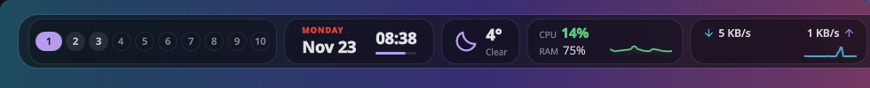
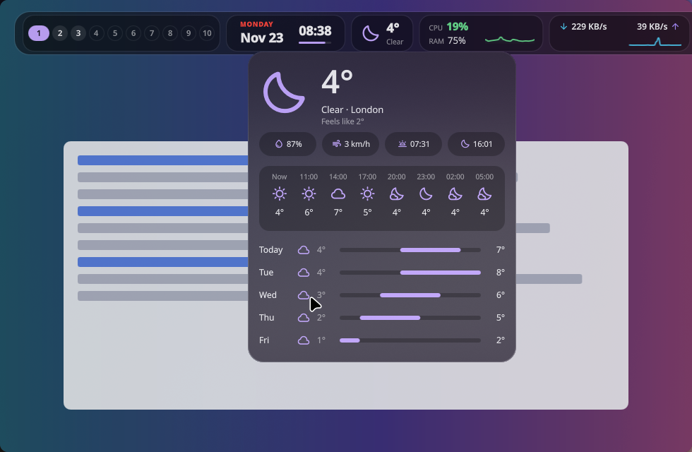
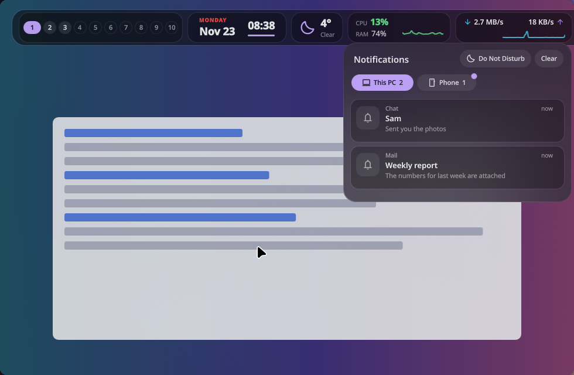

# quickdock

A modular, animated dock / top bar for **Hyprland**, built on [Quickshell](https://quickshell.org). Live widget tiles,
spring motion, Material You colours and a translucent "blur behind" look.

<p align="center"></p>

<p align="center">
  
  
</p>

* 37 ready-made widgets: workspaces, app launcher, clock + calendar, weather, now playing, system stats, tray,
  network speed, clipboard history, notes, notification bell with separate This PC / Phone tabs, a quick-settings
  panel with sliders and toggles, and more.
* Everything is configurable from the UI (drag widgets around in the builder) or one JSON file.
* Writing your own widget is two files: see [docs/WRITING_WIDGETS.md](docs/WRITING_WIDGETS.md).

> **Status:** This is a personal project made public as I had trouble finding what suited me. Bug reports welcome! :)

## Requirements

| | |
|---|---|
| Required | [Quickshell](https://quickshell.org) 0.3+, **Hyprland**, `python3` |
| Icons | the *Material Symbols Rounded* font (your distro's `material-symbols` package; also bundled with DankMaterialShell) |
| Colours | Optional. If [DankMaterialShell](https://danklinux.com) is installed its generated Material 3 palette is used live; otherwise a built-in lavender palette |
| Optional tools | `cliphist` + `wl-clipboard` (clipboard), `playerctl`/MPRIS (now playing), `grim` + `slurp` (screenshots), `upower`, `tailscale`, `kdeconnect-cli`, `solaar`, `nvidia-smi`, `gh`, `hyprsunset` (Night tile), `jq`. Each only affects its own widget. |
| Focus / notification tiles | The *Focus (Do Not Disturb)* tile and the notification centre button talk to DankMaterialShell (`dms ipc`). With another notification daemon those two tiles do nothing; everything else works. |

## Install

```bash
git clone https://github.com/ondraplocica/quickdock ~/quickdock
cd ~/quickdock
scripts/install.sh --start        # checks dependencies, installs a systemd user service, starts the dock
```

`scripts/install.sh --help` lists the options (`--enable` to start at login, `--uninstall`, `--dry-run`). It never edits
your Hyprland config; add the blur rules below yourself.

Prefer no service? Run it directly: `quickshell -p ~/quickdock`.

### Blur behind (Hyprland)

Add to `hyprland.conf` (this is the Hyprland 0.55 `layerrule` syntax; older versions spell it differently, check the
Hyprland wiki for yours), then reload:

```ini
layerrule = blur on, match:namespace ^quickdock$
layerrule = ignore_alpha 0.1, match:namespace ^quickdock$
layerrule = blur_popups on, match:namespace ^quickdock$
```

Then lower **Dropdown opacity** in the settings (gear on the quick-settings panel). Blur only shows where the
surface is translucent; the floor is 30%.

## Configure

`config/dock.json` is **yours**: it is created the first time you change a setting and is git-ignored, so
`git pull` never overwrites it. Until then the shipped `config/dock.default.json` is used. Edits to the file apply
live. The most useful keys:

| key | values | |
|---|---|---|
| `position` | `"bottom"` / `"top"` | dropdowns open away from the dock |
| `monitor` | e.g. `"DP-1"` | show the dock on this output only (omit to show it on every monitor) |
| `scale` | `0.7` to `1.6` | scales the bar itself |
| `dropdownScale` | `0.7` to `1.8` | scales the dropdowns |
| `opacity` | `0.1` to `1` | bar fill opacity |
| `panelOpacity` | `0.3` to `1` | dropdown / quick-settings opacity (lower = more blur behind) |
| `accent` | colour | accent colour |
| `style` | `"bar"` / `"segments"` / `"pills"` | one shared background / one per segment / one per widget |
| `layout` | `"compact"` / `"sections"` | one centred dock, or a full-width bar with left / centre / right zones |
| `fullWidth`, `margin`, `spacing`, `squareCorners`, `reserveSpace` | | geometry; `reserveSpace` makes windows stop at the dock |
| `widgets` | list of ids | order of widgets; `"|"` starts a new segment, `"@left"` / `"@center"` / `"@right"` start a zone |
| `widgetConfig` | object | per-widget settings, keyed by widget id (`"folder:work"` for a second copy) |

The easiest way to rearrange things is the **bar builder**: `quickshell ipc -p ~/quickdock call dock builder`
(or `scripts/open-builder.sh`). The quick-settings panel has its own builder behind the pencil.

### Restarting

Hot reload is off on purpose: on Hyprland 0.55 a reload while a dropdown is open can crash the compositor. Close the
dropdowns, then `systemctl --user restart quickdock`.

## Widgets

| id | What | Needs |
|---|---|---|
| `workspaces` | Hyprland workspaces 1-10, click or scroll to switch | |
| `apps` | Pinned launchers + running apps, magnify on hover, right-click menu | |
| `focusedwindow` | Icon, title and app of the active window | |
| `clock` | Date + time; dropdown is a month calendar with agenda and world clocks | calendar: your secret iCal address (see `widgets/clock/cal.py`) |
| `weather` | Open-Meteo tile; hourly strip and 5-day range | `widgetConfig.weather = {city, lat, lon}` (defaults to London) |
| `nowplaying` | MPRIS art, equalizer, progress | |
| `nextevent` | Next calendar event with a countdown | calendar as for `clock` |
| `sysstats` | CPU/RAM with sparkline | |
| `gpu` | NVIDIA temperature + utilisation | `nvidia-smi` |
| `network` | Live up/down speed + 60 s graph, interface, IP | |
| `tray` | StatusNotifier tray icons | |
| `notifications` | Bell with **This PC / Phone** tabs, unread badge, repeats from KDE Connect collapsed | KDE Connect for the Phone tab |
| `dnd` | Do Not Disturb toggle | DankMaterialShell |
| `clipboard` | Clipboard history, search, click to copy | `cliphist`, `wl-clipboard` |
| `notes` | Autosaving scratchpad (`~/.local/share/quickdock/notes.md`) | |
| `recentfiles` | Last 10 files | |
| `screenshot` | Region / window / screen menu + last-shot preview | `grim`, `slurp`, `wl-copy` |
| `tasks` | Google Tasks checklist | one-time OAuth: `widgets/tasks/README.md` |
| `focustimer` | Pomodoro ring + presets | |
| `folder` | A stack of pinned apps / files / folders (`folder:work` for more) | |
| `github` | Contribution heatmap, open PRs, review requests | `gh` logged in |
| `kdeconnect` | Phone battery, ring, ping, send clipboard | `kdeconnect-cli`; `widgetConfig.kdeconnect.device` |
| `peripherals` | Batteries of Logitech (Solaar), Bluetooth and other upower devices as rings (also a "Wired" row for a USB Keychron) | `upower`; `solaar` optional |
| `tailscale` | Tailnet status and peers | `tailscale` |
| `syncthing` | Syncthing folders and devices | Syncthing running |
| `privacy` | Mic / camera / screen-share indicator | |
| `quickconvert` | Currency and unit converter | |
| `quicksettings` | Control-Center style panel: Network/Bluetooth, toggles, shortcuts, Display / Sound / Microphone sliders, media player, settings page | |
| `qtile` | A single quick toggle on the dock: `qtile:night`, `qtile:dark`, `qtile:vpn`, `qtile:awake` | `hyprsunset` for night |
| `claude` | Claude usage: 5-hour / 7-day limit ring, cost and token bars | Claude Code logged in (`~/.claude/.credentials.json`); uses `get-claude-usage` from the claudeCodeUsage plugin (MIT, see NOTICE.md) |
| `antigravity` | Antigravity 5-hour and weekly quota per model group | an Antigravity / `agy` process running (reads its local server; shows the last reading otherwise) |
| `home` | Home Assistant: on/off and brightness for pinned entities | `~/.config/quickdock/ha.json` = `{"url": "...", "token": "..."}`, pins in `widgetConfig.home` |
| `protonpass` | Show / hide the Proton Pass desktop app as a dropdown | flatpak `me.proton.Pass` + Hyprland window rules, see below |
| `recorder` | Screen recorder: whole screen, a region or the active window; red dot and timer while recording, recent recordings in the dropdown (`quickshell ipc call dock toggle recorder` starts/stops, handy for a keybind) | `wf-recorder` (or `wl-screenrec`), `slurp` for regions; `widgetConfig.recorder` = `{dir, defaultMode, audio}` |
| `repos` | Git overview: how many repositories have uncommitted changes or unpushed / unpulled commits; the dropdown lists them (click opens the folder). Read-only, "Fetch all" is the only network access | `git`; `widgetConfig.repos` = `{roots, repos, exclude, worktrees, open}`, scans `~` one level deep by default |
| `wallpaper` | Thumbnail grid of your wallpaper folder; click to set, Random | one of `dms`, `awww`, `swww`, `hyprpaper` (autodetected) or `widgetConfig.wallpaper.command` with `{file}`; folders in `widgetConfig.wallpaper.dirs` |
| `codex` | OpenAI Codex CLI limits: ring + percentage of the fullest window (weekly and/or 5-hour), the dropdown shows each window, its reset time, plan and credits | the `codex` CLI used at least once; reads the rate limits it logs in `~/.codex/sessions` (no network, no login token), updates while Codex runs |
| `example` | Template widget to copy | |

### Proton Pass dropdown

The `protonpass` tile (also a quick-settings tile) parks the flatpak app on a hidden workspace and brings it back next to
the dock; `scripts/place-window.sh` positions it. Add these window rules to `hyprland.conf` so it floats at a fixed size
(Hyprland 0.55 syntax; the app's minimum width is 881):

```ini
windowrule = float 1, match:class ^(me\.proton\.Pass)$
windowrule = size 881 760, match:class ^(me\.proton\.Pass)$
```

Optional: start it parked so the first click is instant: `exec-once = [workspace special:protonpass silent] flatpak run me.proton.Pass`.

## Writing a widget

Two files, no registry. See **[docs/WRITING_WIDGETS.md](docs/WRITING_WIDGETS.md)** and copy `widgets/example`.
Keep private widgets out of the repo with `scripts/new-widget.sh <id>`: they live in `~/.config/quickdock/widgets/` and survive `git pull`.

## Layout of the repo

| Path | Purpose |
|---|---|
| `shell.qml` | Layer-shell window, loads the widgets listed in the config |
| `config/dock.default.json` | shipped defaults; your settings go in `config/dock.json` (git-ignored) |
| `core/` | `Theme` (tokens), `Dock` (live config), `Tile`, `Popover`, `Quick` (quick tiles), `QsStyle` (Material surface), controls |
| `widgets/<id>/` | one folder per widget: `manifest.json` + `Widget.qml` |
| `scripts/` | installer, widget scaffolder, builder launcher, window placement helper, Google OAuth helper |

## Known limitations

* Hyprland only; there is no Sway / niri / KDE support.
* The notification bell reads the session bus, so it only shows what arrived since the dock started.
* Crash rule for contributors: never anchor a popup (`PopupWindow`, `QsMenuAnchor`, `Popover`) to a Repeater/Loader
  delegate; delegates are destroyed when the dock rebuilds and Quickshell can segfault. Anchor to a stable item inside
  the widget (see `widgets/apps`).

## Licence

MIT, see [LICENSE](LICENSE). Third-party notes: [NOTICE.md](NOTICE.md).
